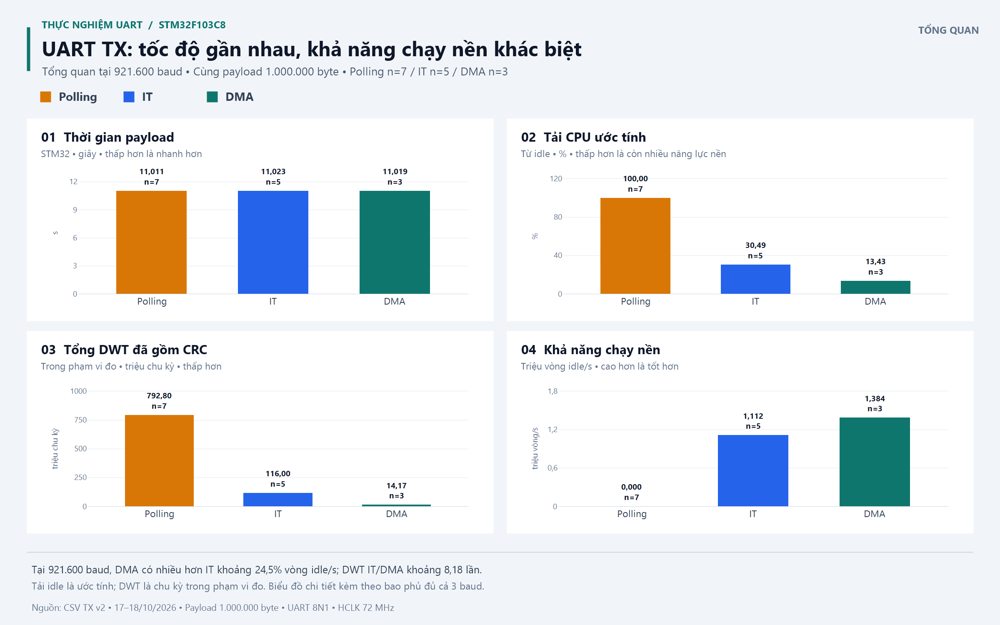

# BÁO CÁO TÓM TẮT: ĐÁNH GIÁ HIỆU NĂNG UART TRÊN STM32

**Thực nghiệm:** 17–18/10/2026.  
**Bản đầy đủ:** [Báo cáo chi tiết](BAO_CAO_UART_CHI_TIET.md), gồm cơ chế, công thức,
giải thích cột CSV, bảng/biểu đồ so sánh, phân tích và nguồn dữ liệu.

## 1. Mục tiêu và cách đo

So sánh TX polling/interrupt/DMA về thời gian, chi phí CPU và khả năng làm việc song song;
kiểm tra RX 1 MB tại 921600 bằng DMA circular + IDLE line.

Mô hình PC/Python ↔ USB-UART ↔ USART1 STM32F103C8, 8N1, HCLK 72 MHz.
Payload mỗi lượt là **1.000.000 byte**, TX chia khối 256 byte và cập nhật CRC phần cứng.
RX dùng circular buffer 1024 byte chia hai nửa A/B và CRC32 tương thích zlib.

| Tiêu chí | Cách đánh giá |
| --- | --- |
| Truyền đúng | Đủ số byte và CRC PC/STM32 khớp |
| Thời gian TX | Mốc STM32 từ trước lời gọi HAL đầu đến khi payload cuối phát xong; không gồm trailer/báo cáo |
| Chi phí CPU | Tổng DWT trong phạm vi phần mềm đang đo; đã gồm CRC |
| Tải CPU ước tính | Mức giảm số vòng idle so với chuẩn hiệu chuẩn mỗi giây |
| Làm việc song song | Số vòng idle mỗi giây trong cửa sổ payload; PC13 toggle khi chạy nền |

```text
T_STM32 = idle_elapsed_ms / 1000
Tải CPU idle (%) = 100 × [1 − so_vong_lap_idle / (idle_max_count × T_STM32)]
Vòng idle/s = so_vong_lap_idle / T_STM32
```

`idle_elapsed_ms` là thời lượng toàn cửa sổ quan sát, không chỉ thời gian CPU rảnh.
Thời gian PC giữ riêng để đối chiếu và không dùng tính tải CPU.
So sánh riêng từng baud; chỉ tính trung bình lượt thành công và dùng chỉ số có trạng thái hợp lệ.

## 2. Kết quả TX

Tập CSV hiện có **45/45 lượt TX đủ payload và CRC khớp**. Số lần lặp không đều giữa các nhóm.

| Baud | Phương pháp | Thành công/lượt | Thời gian STM32 (s) | Tổng DWT (triệu chu kỳ) | Tải idle (%) | Vòng idle/s |
| ---: | --- | ---: | ---: | ---: | ---: | ---: |
| 115.200 | Polling | 8/8 | 87,009 | — | 100,00 | 0 |
| 115.200 | IT | 2/2 | 87,009 | 116,001 | 14,13 | 1.373.187 |
| 115.200 | DMA | 4/4 | 87,009 | 14,173 | 11,98 | 1.407.678 |
| 921.600 | Polling | 7/7 | 11,011 | 792,801 | 100,00 | 0 |
| 921.600 | IT | 5/5 | 11,023 | 115,998 | 30,49 | 1.111.625 |
| 921.600 | DMA | 3/3 | 11,019 | 14,173 | 13,43 | 1.384.373 |
| 1.500.000 | Polling | 3/3 | 6,846 | 492,941 | 100,00 | 0 |
| 1.500.000 | IT | 8/8 | 6,854 | 117,751 | 42,16 | 924.980 |
| 1.500.000 | DMA | 5/5 | 6,855 | 14,417 | 14,54 | 1.366.531 |

**“—” không phải 0:** tám lượt polling tại 115200 có `WRAP_RISK` do thời gian khoảng 87 s
vượt một vòng DWT 32 bit khoảng 59,65 s ở 72 MHz. DWT nhóm này được loại khỏi so sánh;
thời gian STM32, idle và kết quả kiểm tra dữ liệu vẫn dùng được.

**Biểu đồ tổng quan tại 921600 baud** — cùng payload 1.000.000 byte; mỗi cột ghi số lượt hợp lệ `n`.
Các biểu đồ đầy đủ ba baud nằm trong [bản chi tiết, mục 7.4](BAO_CAO_UART_CHI_TIET.md#74-biểu-đồ-so-sánh).



Các kết quả chính:

- Cùng baud, thời gian ba phương pháp gần nhau do cùng giới hạn phát bit của UART.
- Polling chặn main nên không chạy được tác vụ nền trong cửa sổ truyền.
- IT cho phép chạy nền nhưng cần CPU phục vụ nhiều ngắt theo byte; tăng baud làm cơ hội chạy nền giảm.
- DMA chuyển byte bằng phần cứng, CPU chủ yếu xử lý theo khối. Tại 921600, DWT IT/DMA
  chênh khoảng **8,18 lần**; DMA thực hiện được nhiều hơn IT khoảng **24,5%** bước idle/s.
- Tại 1500000, lợi thế công việc nền DMA so với IT khoảng **47,7%**.
  DMA không nhất thiết truyền nhanh nhất; lợi ích chính là giảm chi phí CPU và hỗ trợ công việc song song.

## 3. Kết quả RX DMA + IDLE

CSV RX có **3/3 lượt nhận đủ 1.000.000 byte tại 921600**, các CRC đều khớp:
`87D81AED`, `F63EF583`, `DF0A2FEF`. Tổng payload nhận đúng là 3.000.000 byte.

Thời gian giao dịch PC trung bình **11,959306 s**, gồm ghi/flush và chờ phản hồi RESULT;
không so trực tiếp với thời gian payload TX trên STM32.
Kết luận không mất byte áp dụng cho ba lượt đã ghi nhận, không bảo đảm mọi tải hệ thống.

## 4. Giới hạn và mức đáp ứng

- Tick STM32 có độ phân giải 1 ms; mốc TC ghi bằng phần mềm. Chênh lệch vài ms không đủ
  để khẳng định một phương pháp luôn nhanh hơn.
- DWT IT/DMA chưa gồm đầy đủ chi phí phần cứng vào/ra ngắt. Tải idle có sai lệch do vòng
  hiệu chuẩn/main khác điều kiện kiểm tra, nên là chỉ số ước tính khả năng chạy nền.
- Seed hiện tại khác nhau, CSV không lưu lịch sử phiên bản/mức tối ưu. Không khẳng định
  cùng từng byte payload hoặc kiểm soát tuyệt đối mọi điều kiện giữa các lượt.
- Đã có TX ba phương pháp ở ba baud, kiểm tra CRC và RX 1 MB tại 921600.
  Chưa có ảnh logic analyzer hoặc số liệu RX với độ dài khác 1 MB trong dữ liệu cung cấp.
  RX cũng chưa báo tràn khi main xử lý chậm hơn DMA.

## 5. Kết luận

Trong mô hình thực nghiệm này, thời gian truyền chủ yếu do baud quyết định; DMA giảm rõ
chi phí xử lý phần mềm và duy trì được nhiều công việc nền hơn. Kết quả RX xác nhận nhận
đúng 1 MB tại 921600 trong các lượt đã đo. Để hoàn thiện minh chứng, bổ sung ảnh TX/PC13,
thử RX nhiều độ dài/biên buffer và xử lý tràn DWT nếu cần đo polling tại 115200.

## Nguồn

[Polling TX](../../TEST_PYTHON/uart_polling_tx_v2_results.csv) ·
[IT TX](../../TEST_PYTHON/uart_it_tx_v2_results.csv) ·
[DMA TX](../../TEST_PYTHON/uart_dma_tx_v2_results.csv) ·
[DMA RX](../../TEST_PYTHON/uart_dma_rx_results.csv).

Các bảng phụ, công thức có ví dụ, biểu đồ và dấu đối chiếu dữ liệu nằm trong
[bản chi tiết](BAO_CAO_UART_CHI_TIET.md). Ảnh PNG có độ phân giải 2400 × 1500 pixel,
đặt trong thư mục `hinh/`; giữ thư mục này cùng hai file Markdown khi sao chép báo cáo.
