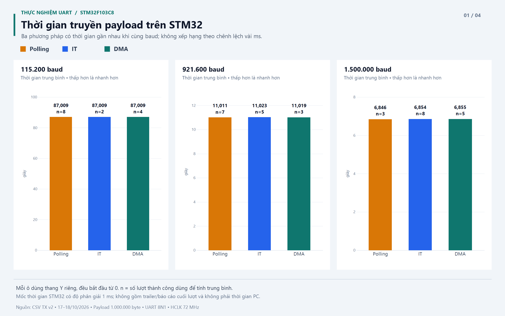
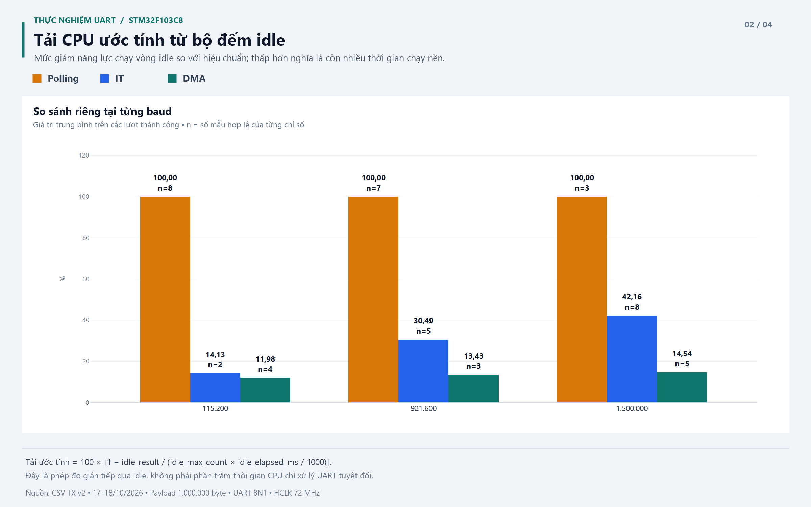
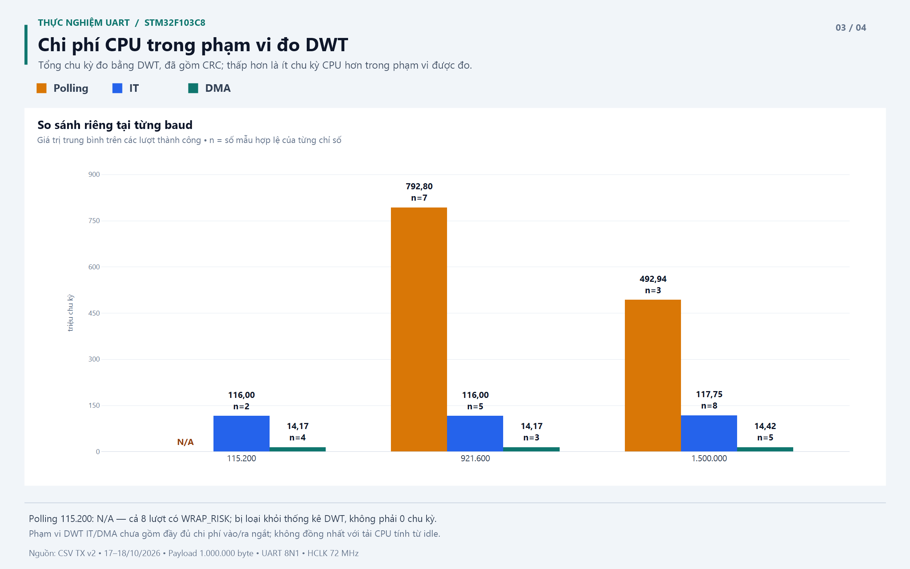
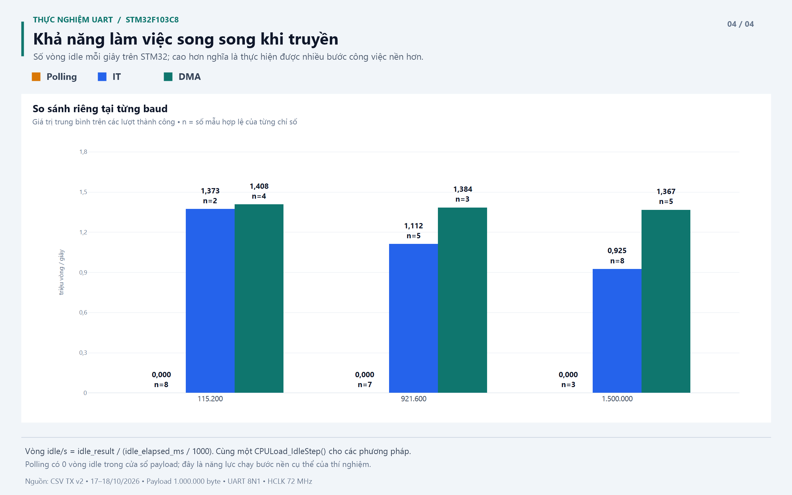

# BÁO CÁO CHI TIẾT: ĐÁNH GIÁ HIỆU NĂNG UART TRÊN STM32

**Thời gian thực nghiệm:** 17–18/10/2026, giờ Việt Nam.  
**Phạm vi:** TX polling/interrupt/DMA; RX DMA circular kết hợp IDLE line.  
**Dữ liệu:** 45 lượt TX và 3 lượt RX trong các CSV hiện có.  
**Bản đọc nhanh:** [Báo cáo tóm tắt](BAO_CAO_UART.md).

## 1. Mục tiêu và câu hỏi nghiên cứu

Đề tài khảo sát ba cách sử dụng UART khi truyền khối dữ liệu lớn: polling, interrupt và DMA.
Ngoài việc truyền đúng dữ liệu, cần đánh giá thời gian hoàn thành, chi phí CPU và khả năng
CPU thực hiện công việc khác khi UART đang hoạt động. Phía nhận sử dụng DMA circular và
IDLE line để xử lý luồng dữ liệu, kiểm tra số byte và CRC.

Các câu hỏi cần trả lời:

1. Ở cùng baud và cùng độ dài payload, ba phương pháp khác nhau nhiều về thời gian không?
2. Phương pháp nào cần ít chu kỳ xử lý phần mềm hơn?
3. Trong lúc truyền, CPU còn thực hiện được bao nhiêu công việc nền?
4. Khi tăng baud, tải xử lý và hiệu quả của IT/DMA thay đổi thế nào?
5. RX có nhận đủ 1 MB ở 921600 baud và giữ nguyên nội dung dữ liệu không?

Mục tiêu của thí nghiệm là so sánh trong điều kiện phần cứng và cách đo của bài tập.
Các kết quả thời gian không được diễn giải thành phép đo chính xác từng byte hoặc từng cạnh tín hiệu.

## 2. Mô hình và điều kiện thực nghiệm

```text
                            TX: STM32 → PC
PC/Python ← USB-UART ← USART1 / STM32F103C8
PC/Python → USB-UART → USART1 / STM32F103C8
                            RX: PC → STM32

PC13: tăng bộ đếm công việc nền và toggle GPIO trong CPULoad_IdleStep().
```

| Thành phần | Điều kiện được xác nhận từ code/dữ liệu |
| --- | --- |
| Vi điều khiển | Dự án STM32F103C8; các lượt TX báo HCLK 72 MHz |
| UART | USART1, 8 bit dữ liệu, không parity, 1 stop bit: 8N1 |
| Kết nối | PC qua USB-UART; CSV RX ghi cổng COM4, chưa xác nhận model cụ thể của bộ chuyển đổi |
| Payload | 1 MB trong báo cáo này là **1.000.000 byte**, không phải 1 MiB |
| Baud khảo sát TX | 115200, 921600, 1500000 |
| Khối TX | 256 byte; 3.906 khối đầy và một khối cuối 64 byte |
| Nội dung TX | Xorshift32; code hiện tại dùng seed khác giữa các phương pháp |
| Kiểm tra TX | CRC phần cứng STM32F1, cập nhật theo khối; PC tính lại theo cùng cách ghép word |
| Buffer RX | Circular 1024 byte, chia A/B mỗi nửa 512 byte |
| Kiểm tra RX | Đếm payload và CRC32 phần mềm tương thích `zlib.crc32()` |
| Công việc nền | Tăng `idle_counter` và toggle PC13 |

Chuẩn so sánh là cùng baud, độ dài, clock, kích thước khối và cùng loại công việc CRC.
Do CSV không lưu lịch sử firmware/mức tối ưu và code hiện tại có seed khác nhau, không khẳng định
mọi lượt dùng cùng từng byte payload hoặc mọi điều kiện biên dịch được kiểm soát tuyệt đối.
Số liệu phản ánh cùng quy mô và thuật toán công việc trong phạm vi thí nghiệm đã ghi nhận.

## 3. Cơ chế ba phương pháp TX

### 3.1. Polling

CPU gọi `HAL_UART_Transmit()` và kiểm tra cờ phần cứng cho đến khi hoàn thành khối.
Sau đó CPU cập nhật CRC, chuẩn bị khối tiếp theo và tiếp tục gọi hàm truyền.

```text
main → sinh dữ liệu → truyền/chờ cờ UART → CRC → khối tiếp theo → ...
                     CPU ở trong hàm blocking
```

UART vẫn là phần cứng phát bit; polling làm CPU phải chủ động chờ và cấp dữ liệu.
Trong triển khai này main chưa quay lại vòng chạy nền khi truyền, nên `so_vong_lap_idle = 0`.
Tải CPU theo phương pháp idle vì thế bằng 100% khi số liệu hiệu chuẩn/thời lượng hợp lệ.
Đây là đặc điểm của cách triển khai blocking hiện tại, không phải kết luận CPU không thể
phục vụ bất kỳ ngắt nào trong thời gian đó.

### 3.2. Interrupt — IT

Lời gọi `HAL_UART_Transmit_IT()` khởi động truyền rồi trả về. Khi UART cần dữ liệu hoặc
hoàn tất một khối, CPU vào ngắt để xử lý. Main có thể chạy công việc nền giữa các lần ngắt.

```text
main:       idle ── idle ── idle ── idle ...
UART IRQ:        cấp byte      cấp byte ... hoàn tất khối
callback:                                  CRC + chuẩn bị khối tiếp
```

IT giải phóng main khỏi hàm chờ liên tục, nhưng UART TX bằng ngắt vẫn cần CPU phục vụ
nhiều sự kiện theo byte. Với payload cố định, tăng baud làm các yêu cầu xử lý đến dày hơn
trong một khoảng thời gian ngắn hơn, giảm cơ hội chạy nền.

### 3.3. DMA

`HAL_UART_Transmit_DMA()` cấu hình DMA chuyển dữ liệu từ RAM đến UART. CPU không phải
ghi từng byte như đường IT. CPU vẫn xử lý ngắt DMA/USART, CRC và chuẩn bị các khối tiếp theo.

```text
RAM ── DMA ── UART ── đường truyền

CPU:  khởi động → chạy idle → xử lý sự kiện khối/CRC → chạy idle → ...
```

DMA không làm tốc độ phát bit của UART vượt baud đã đặt. Lợi ích chính là giảm số lần CPU
phải tham gia chuyển byte và tăng thời gian có thể dành cho công việc khác.
Thiết kế hiện tại nối các khối 256 byte, nên vẫn có chi phí chuẩn bị giữa các khối;
không diễn giải nó như một DMA duy nhất tự truyền toàn bộ 1 MB mà CPU không tham gia.

## 4. Luồng dữ liệu và các mốc đo

### 4.1. Giao thức TX

```text
1.000.000 byte payload → 4 byte CRC → DWT2 (20 byte) → IDL2 (24 byte)
```

| Gói báo cáo | Thành phần theo thứ tự |
| --- | --- |
| DWT2 | Magic `DWT2`; mode; tổng chu kỳ CPU; chu kỳ CRC; HCLK |
| IDL2 | Magic `IDL2`; số vòng idle; thời lượng idle ms; chuẩn idle vòng/s; byte payload đã phát; thời lượng payload ms |

Các số nguyên của hai gói được đóng gói uint32 little-endian. Mode phân biệt polling/IT/DMA.
Python đọc báo cáo sau payload và trailer CRC; thời gian đọc báo cáo không được cộng vào thời gian nhận payload PC.

### 4.2. Cửa sổ thời gian STM32 và idle

```text
Hiệu chuẩn 1 s → sinh khối đầu → START PAYLOAD
  → HAL phát khối đầu
  → các khối giữa: phát xong / cập nhật CRC / sinh khối tiếp
  → payload cuối phát xong → STOP PAYLOAD + chốt idle
  → CRC khối cuối / trailer CRC → báo cáo DWT2 → báo cáo IDL2
```

`UART_Test_PayloadStart()` chạy ngay trước lời gọi HAL phát khối payload đầu.
Polling dừng thời gian sau khi HAL đã chờ hoàn tất khối cuối; IT/DMA dừng trong callback
hoàn tất phát payload cuối qua USART. Đây là mốc phần mềm quan sát trạng thái TC.

Cửa sổ này gồm thời gian phát và khoảng xử lý giữa các khối, nhưng không gồm sinh khối đầu,
tính CRC của khối cuối, trailer CRC và các gói báo cáo. Khi chốt, code lưu:

```c
idle_elapsed_ms = HAL_GetTick() - idle_start_ms;
idle_result = idle_counter;
payload_elapsed_ms = idle_elapsed_ms;
payload_bytes_sent = payload_bytes;
```

Do đó, `idle_elapsed_ms` là thời lượng **toàn cửa sổ quan sát**, gồm cả lúc CPU xử lý UART
và lúc chạy idle. Nó không phải thời gian CPU rảnh. Trong triển khai hiện tại,
`thoi_gian_payload_stm32_s = idle_elapsed_ms / 1000` vì hai cửa sổ đo trùng nhau.

### 4.3. Cửa sổ DWT

| Phương pháp | Phạm vi chu kỳ đang được ghi nhận |
| --- | --- |
| Polling | Một đoạn liên tục gồm sinh dữ liệu, truyền/chờ UART và CRC, đến khi trailer CRC truyền xong |
| IT | Sinh khối đầu, gọi HAL ban đầu và tổng các đoạn HAL/callback trong ngắt USART |
| DMA | Sinh khối đầu, gọi HAL ban đầu và tổng các đoạn HAL/callback trong ngắt DMA/USART |

DWT IT/DMA không cộng thời gian main chạy idle giữa các ngắt. Tổng DWT đã bao gồm phần
`CRC32_Update()` được đo riêng. Cửa sổ DWT rộng/khác cửa sổ payload ở một số phần xử lý,
nên không coi tổng DWT và thời gian payload là hai đại lượng có cùng phạm vi tuyệt đối.
Chi phí phần cứng vào/ra ngắt và một phần mã bao quanh chưa được đếm đầy đủ; mã đo cũng có chi phí.

## 5. Công thức và cách đọc chỉ số

### 5.1. Thời gian và thông lượng STM32

```text
T_STM32 = payload_elapsed_ms / 1000
Thông lượng STM32 (byte/s) = số byte payload đã phát / T_STM32
```

Đây là thông lượng của bài phát payload, gồm các khoảng xử lý giữa khối. Nó không phải
tốc độ tức thời của từng bit trên dây hoặc phép đo riêng thời gian CPU bận.

### 5.2. Thời gian nhận payload và hiệu suất PC

Python bắt đầu tính thời gian sau khi `read(1)` trả về byte đầu, rồi chốt khi đọc đủ payload.
Mốc này khác STM32 bắt đầu trước lời gọi HAL và kết thúc theo TC; hai đồng hồ cũng khác nhau.
USB-UART, bộ đệm và lịch chạy hệ điều hành làm khoảng đo PC có thể lớn hơn hoặc nhỏ hơn khoảng STM32.

UART 8N1 dùng 10 bit cho một byte payload: 1 start, 8 dữ liệu và 1 stop.

```text
T_phát_bit_tối_thiểu = số byte payload × 10 / baud
Tốc độ payload lý thuyết = baud / 10
Hiệu suất nhận PC (%) = (số byte nhận / T_PC) / (baud / 10) × 100
```

Ví dụ ở 921600 baud, 1 MB cần tối thiểu khoảng 10,850694 s nếu phát liên tục.
Lượt IT cuối có thời gian PC 11,0228408 s, tương ứng hiệu suất khoảng 98,4383%.
Phần còn lại phản ánh khoảng trống và ảnh hưởng phép đo, không có nghĩa mất 1,5617% số byte.

Không cộng trực tiếp thời gian CRC/DWT vào thời gian lý thuyết: CPU và UART có thể hoạt động
chồng lấp trong IT/DMA. Công thức hiện tại là đối chiếu với giới hạn phát bit, không phải
mô hình dự đoán đầy đủ thời gian ứng dụng. Báo cáo dùng thời gian STM32 làm chỉ số TX chính,
giữ thời gian/hiệu suất PC làm số liệu đối chiếu.

### 5.3. Tải CPU ước tính bằng idle

Trước truyền, `CPULoad_Calibrate()` chạy cùng `CPULoad_IdleStep()` khoảng một giây để lấy
`idle_max_count`, đơn vị vòng/s. Khi truyền, mỗi lần main chạy bước idle lại tăng counter.

```text
Số vòng chuẩn kỳ vọng = idle_max_count × idle_elapsed_ms / 1000
idle_pct = so_vong_lap_idle / số vòng chuẩn kỳ vọng × 100
Tải CPU ước tính (%) = 100 − idle_pct
```

Ví dụ lượt IT cuối ở 921600:

```text
idle_max_count    = 1.599.202 vòng/s
idle_elapsed_ms   = 11.023 ms = 11,023 s
so_vong_lap_idle  = 12.253.161 vòng
Vòng chuẩn kỳ vọng ≈ 17.628.003,646
idle_pct          ≈ 69,5096%
Tải CPU ước tính  ≈ 30,4904%
```

Ý nghĩa: khả năng chạy vòng nền giảm khoảng 30,49% so với chuẩn. Cùng hàm idle nhưng
điều kiện kiểm tra trong vòng hiệu chuẩn và main khác nhau; số này có cả ảnh hưởng công việc,
ngắt và sai lệch chi phí vòng lặp. Không gọi nó là phần trăm CPU UART chính xác tuyệt đối,
và không yêu cầu nó bằng tổng DWT chia thời gian payload.

Nếu thiếu số liệu hoặc chuẩn/thời lượng bằng 0, Python để trống tải CPU. Nếu tỷ lệ idle
ngoài [0, 100], trạng thái là `OUT_OF_RANGE`, không ép kết quả về 0/100 để che sai lệch.

### 5.4. Khả năng làm việc song song

```text
Vòng idle mỗi giây = so_vong_lap_idle / (idle_elapsed_ms / 1000)
```

Dùng số vòng/s thay vì số vòng thô khi so sánh các lượt dài ngắn khác nhau.
Tác vụ nền càng thực hiện được nhiều vòng trong cùng một giây thì càng có nhiều cơ hội
phục vụ công việc khác với cùng mô hình idle. Đây là công việc nền cụ thể, không phải
phép đo năng lực xử lý mọi loại tác vụ ứng dụng.

### 5.5. Chu kỳ tổng, UART và CRC

```text
chu_ky_cpu_uart = tong_chu_ky_cpu − chu_ky_cpu_crc
Thời gian CPU trong phạm vi DWT (s) = số chu kỳ / tan_so_cpu_hz
```

`chu_ky_cpu_uart` vẫn gồm sinh dữ liệu, xử lý HAL, đóng gói/gửi CRC và các phần được đo
ngoài chính lời gọi `CRC32_Update()`. Không hiểu nó là chi phí phần cứng UART thuần.
Để so cùng công việc có kiểm tra dữ liệu, tổng DWT là chỉ số chính; tách CRC giúp giải thích kết quả.

## 6. Xử lý dữ liệu và tính công bằng

Các nguồn được dùng là ba CSV TX v2 và CSV RX hiện tại, không gộp dữ liệu TX cũ trong `backup/`.

1. Giữ từng lượt trong dữ liệu nguồn và báo số lần lặp của từng nhóm.
2. Nhóm riêng theo phương pháp và baud; payload cùng 1.000.000 byte, TX cùng HCLK 72 MHz.
3. Chỉ lấy trung bình chỉ số từ lượt thành công và có số liệu tương ứng.
4. DWT chỉ dùng khi `trang_thai_dwt = OK`; idle chỉ dùng khi `trang_thai_do_idle = OK`.
5. Không dùng ô thiếu như số 0; không sửa giá trị gốc để làm đẹp kết quả.
6. Tất cả kết quả ở đây là thống kê mô tả; số lần lặp 2–8 lượt/nhóm không dùng để khẳng định
   xác suất không lỗi hoặc kết luận chênh lệch thời gian rất nhỏ có ý nghĩa thống kê.

Tập CSV hiện tại có 45 lượt TX thành công và 3 lượt RX thành công. Đây là kết quả trong
tập dữ liệu được cung cấp, không khẳng định toàn bộ lịch sử chạy thử chưa từng gặp lỗi.

## 7. Kết quả TX ở ba baud

### 7.1. Bảng so sánh chính

Các số là trung bình trong từng nhóm. DWT có đơn vị **triệu chu kỳ**; tải CPU là ước tính từ idle.

| Baud | Phương pháp | Thành công/lượt | Thời gian STM32 (s) | Tổng DWT | Tải idle (%) | Vòng idle/s |
| ---: | --- | ---: | ---: | ---: | ---: | ---: |
| 115.200 | Polling | 8/8 | 87,009 | — | 100,00 | 0 |
| 115.200 | IT | 2/2 | 87,009 | 116,001 | 14,13 | 1.373.187 |
| 115.200 | DMA | 4/4 | 87,009 | 14,173 | 11,98 | 1.407.678 |
| 921.600 | Polling | 7/7 | 11,011 | 792,801 | 100,00 | 0 |
| 921.600 | IT | 5/5 | 11,023 | 115,998 | 30,49 | 1.111.625 |
| 921.600 | DMA | 3/3 | 11,019 | 14,173 | 13,43 | 1.384.373 |
| 1.500.000 | Polling | 3/3 | 6,846 | 492,941 | 100,00 | 0 |
| 1.500.000 | IT | 8/8 | 6,854 | 117,751 | 42,16 | 924.980 |
| 1.500.000 | DMA | 5/5 | 6,855 | 14,417 | 14,54 | 1.366.531 |

### 7.2. Đối chiếu thời gian PC và hiệu suất nhận

Chênh lệch bên dưới là **trung bình thời gian STM32 − trung bình thời gian PC**.
Nó không phải độ trễ truyền một chiều của USB-UART.

| Baud | Phương pháp | Thời gian PC (s) | STM32 − PC (ms) | Hiệu suất nhận PC (%) |
| ---: | --- | ---: | ---: | ---: |
| 115.200 | Polling | 87,004210 | 4,790 | 99,7717 |
| 115.200 | IT | 87,003944 | 5,056 | 99,7720 |
| 115.200 | DMA | 87,004339 | 4,661 | 99,7715 |
| 921.600 | Polling | 11,010306 | 0,694 | 98,5503 |
| 921.600 | IT | 11,022919 | 0,081 | 98,4376 |
| 921.600 | DMA | 11,018596 | 0,404 | 98,4762 |
| 1.500.000 | Polling | 6,845818 | 0,182 | 97,3831 |
| 1.500.000 | IT | 6,853650 | 0,350 | 97,2718 |
| 1.500.000 | DMA | 6,854769 | 0,231 | 97,2559 |

Các giá trị gần nhau phù hợp với việc cùng quan sát một lượt payload. Phần chênh lệch có
thể đến từ cặp mốc khác nhau, USB/driver, lịch chạy Python và hai đồng hồ. Dữ liệu không
đủ để tách riêng từng nguyên nhân. Đặc biệt, không quy toàn bộ chênh lệch vài ms cho lượng tử hóa 1 ms.

### 7.3. Tách phần CRC trong DWT

| Baud | Phương pháp | DWT ngoài `CRC32_Update()` (triệu) | DWT CRC (triệu) |
| ---: | --- | ---: | ---: |
| 115.200 | Polling | — | — |
| 115.200 | IT | 113,134 | 2,867 |
| 115.200 | DMA | 11,314 | 2,859 |
| 921.600 | Polling | 789,951 | 2,849 |
| 921.600 | IT | 113,132 | 2,866 |
| 921.600 | DMA | 11,314 | 2,859 |
| 1.500.000 | Polling | 490,088 | 2,853 |
| 1.500.000 | IT | 114,884 | 2,867 |
| 1.500.000 | DMA | 11,558 | 2,859 |

Chi phí cập nhật CRC gần nhau về độ lớn, trong khi phần chi phí còn lại chênh lệch rõ.
Điều này phù hợp với việc ba bài đều cập nhật CRC phần cứng cho cùng lượng dữ liệu,
còn cơ chế cấp dữ liệu/chờ UART khác nhau. Bảng này bỏ nhóm polling 115200 theo trạng thái DWT tổng,
không đưa số chu kỳ thô chưa hợp lệ vào so sánh.

### 7.4. Biểu đồ so sánh

Các ảnh PNG trong `hinh/` có độ phân giải **2400 × 1500 pixel**, dùng chung màu:
Polling cam, IT xanh dương, DMA xanh lục. Giá trị trên cột là **trung bình của các lượt
thành công có chỉ số hợp lệ**; `n` là số lượt được dùng cho chỉ số đó.
Ảnh thể hiện trung bình, không thể hiện độ phân tán hay khoảng tin cậy; không suy ra
ý nghĩa thống kê từ chiều cao cột khi số lượt lặp còn ít và không đều.

**Hình 1. Thời gian truyền payload trên STM32 tại ba baud.**



Mỗi ô có thang thời gian riêng và đều bắt đầu từ 0; so sánh ba phương pháp **trong cùng ô**.
Các thời gian gần nhau do cùng giới hạn phát bit của UART. Không dùng chênh lệch vài ms
để khẳng định thứ hạng tốc độ. Đây là cửa sổ payload đo trên STM32, không phải thời gian nhận tại PC.

**Hình 2. Tải CPU ước tính bằng bộ đếm idle.**



Polling không có vòng idle trong cửa sổ payload nên chỉ số bằng 100%; IT và DMA vẫn chạy nền.
Tải này biểu diễn mức giảm năng lực chạy bước idle so với hiệu chuẩn, có giới hạn như mục 6;
không xem là phép đo tuyệt đối phần thời gian CPU chỉ xử lý UART.

**Hình 3. Tổng chu kỳ CPU trong phạm vi đo DWT, đã gồm CRC.**



Polling tại 115200 ghi **N/A** vì cả tám lượt có `WRAP_RISK`; không coi đây là 0 chu kỳ.
Phạm vi DWT IT/DMA chưa bao quát đầy đủ chi phí vào/ra ngắt. DWT và tải idle là hai chỉ số
khác nhau, không đổi trực tiếp tỷ lệ chu kỳ trong hình thành phần trăm tải idle.

**Hình 4. Khả năng làm việc song song, chuẩn hóa theo số vòng idle mỗi giây.**



Chuẩn hóa theo thời gian giúp tránh việc lượt kéo dài hơn tự nhiên tích lũy nhiều vòng idle hơn.
Đây là số bước công việc nền cụ thể của `CPULoad_IdleStep()`, không phải số tác vụ ứng dụng
bất kỳ. Tại 921600 baud, DMA thực hiện nhiều hơn IT khoảng 24,5% vòng idle/s;
tại 1500000 baud, mức chênh khoảng 47,7%.

**Ảnh tổng quan dành cho trình bày:** [Bốn tiêu chí tại 921600 baud](hinh/tong_quan_uart.png).
Ảnh này chọn một baud để trình bày gọn; bốn hình phía trên chứa đủ ba baud của thí nghiệm.

## 8. Phân tích kết quả và nguyên nhân

### 8.1. Tại sao cùng baud thì thời gian gần nhau?

Với 8N1 và 1 MB, giới hạn phát bit theo baud đặt là:

| Baud | Thời gian phát liên tục lý thuyết (s) |
| ---: | ---: |
| 115.200 | 86,805556 |
| 921.600 | 10,850694 |
| 1.500.000 | 6,666667 |

Ba phương pháp đều phải đi qua cùng phần cứng UART, nên không thể loại bỏ thời gian phát bit.
Phần mềm tạo thêm khoảng trống và chi phí chuẩn bị. Vì thế khác biệt thời gian chỉ vài ms
không tương ứng với khác biệt lớn về số chu kỳ CPU.

Ở 921600, polling có thời gian trung bình 11,011 s, IT 11,023 s và DMA 11,019 s.
Ở 1500000, IT còn có thời gian 6,854 s so với DMA 6,855 s. Những kết quả này cho thấy
không nên kết luận DMA luôn truyền nhanh nhất. Với cách đo hiện tại, mục tiêu có ý nghĩa
hơn là duy trì tốc độ truyền gần nhau trong khi giảm phần tham gia của CPU.

### 8.2. Vì sao polling bận CPU nhiều?

Trong polling, CPU liên tục kiểm tra cờ và chờ UART thay vì trở lại main để chạy tác vụ nền.
DWT vì thế bao gồm cả khoảng chờ. Khi tăng baud, thời gian chờ giảm, làm số chu kỳ tổng giảm
từ khoảng 792,801 triệu tại 921600 xuống 492,941 triệu tại 1500000.
Polling đơn giản, thuận tiện khi ít dữ liệu hoặc không cần công việc song song, nhưng triển khai
blocking này không phù hợp với mục tiêu duy trì tác vụ nền trong một lượt truyền lớn.

### 8.3. Vì sao IT giảm chu kỳ nhưng tải idle tăng theo baud?

IT không đợi toàn bộ lượt trong một hàm blocking, nên main có cơ hội chạy nền.
Tuy nhiên, việc cấp byte qua ngắt gây nhiều lần chuyển sang xử lý UART.
Khi tăng baud, cùng số byte được phục vụ trong thời gian ngắn hơn: tổng công việc gần như
giữ nguyên nhưng mức độ chiếm dụng theo thời gian tăng.

Tổng DWT IT từ khoảng 116,001 đến 117,751 triệu chu kỳ, trong khi tải idle ước tính tăng
từ 14,13% tại 115200 lên 42,16% tại 1500000. Hai xu hướng này không mâu thuẫn:
một đại lượng là lượng công việc tích lũy, đại lượng còn lại là mức suy giảm khả năng chạy nền
trong cửa sổ truyền, với cách hiệu chuẩn và phạm vi đo riêng.

### 8.4. Lợi ích DMA thể hiện ở đâu?

Tại 921600, tổng DWT IT/DMA xấp xỉ **8,18 lần** trong phạm vi được đo.
Số vòng nền mỗi giây tăng từ khoảng 1.111.625 của IT lên 1.384.373 của DMA,
tức DMA thực hiện được nhiều hơn khoảng **24,5%** bước công việc nền.

Ở 1500000, IT đạt khoảng 924.980 vòng/s, DMA khoảng 1.366.531 vòng/s;
mức tăng công việc nền khoảng **47,7%**, còn tỷ số tổng DWT IT/DMA khoảng **8,17 lần**.
Khi baud tăng, ưu thế giảm sự tham gia của CPU càng thể hiện rõ trong mô hình công việc này.

DMA vẫn có tải nền đo được do CRC, sinh dữ liệu, callback, chuẩn bị khối và chi phí vòng lặp.
Không quy toàn bộ con số tải idle 11,98–14,54% thành chi phí chuyển byte của DMA:
đặc biệt ở baud thấp, sai lệch chuẩn hóa giữa vòng hiệu chuẩn/main có thể chiếm tỷ trọng đáng kể.

### 8.5. Số liệu gần trùng nhau có đáng ngờ không?

Sau reset, chương trình thực hiện cùng một luồng công việc với số byte, kích thước khối
và seed cố định của phiên bản đang chạy. Các bộ đếm nguyên trên STM32 có thể lặp lại rất sát.
Thời gian STM32 lại có độ phân giải 1 ms, nên các lượt khác nhau vài chục microsecond
vẫn có thể ghi cùng một giá trị thời gian.

Trong 5 lượt IT tại 921600, thời gian PC nằm trong khoảng 11,0227876–11,0230721 s,
chênh tối đa khoảng 0,2845 ms; tổng DWT chênh khoảng 0,0135% so với trung bình.
Điều này thể hiện độ lặp lại cao trong tập dữ liệu. Nó không chứng minh phép đo không có sai lệch cố định.

### 8.6. Chứng minh CPU làm việc khác khi DMA đang truyền

Polling có counter nền bằng 0, còn IT/DMA có counter dương trong chính cửa sổ payload.
Đây là bằng chứng bằng số về việc main tiếp tục thực hiện `CPULoad_IdleStep()` trong khi
UART chưa truyền xong. Công việc này gồm tăng biến và toggle PC13, không chỉ là một biến
được gán sẵn sau khi truyền.

Logic analyzer có thể quan sát đồng thời TX và PC13: các cạnh PC13 xuất hiện trong khoảng TX
đang phát là minh chứng trực quan. Mỗi bước idle toggle một lần; một chu kỳ sóng vuông đầy đủ
có hai lần toggle. Chưa có ảnh logic analyzer trong dữ liệu cung cấp, nên báo cáo không khẳng định
đã kiểm chứng bằng ảnh đo hoặc đo chính xác từng cạnh.

## 9. Phía nhận: DMA circular và IDLE line

### 9.1. Giao thức và xử lý dữ liệu

```text
PC gửi:       Length 4 byte little-endian + Payload
STM32 trả:    RESULT,DONE,<số byte payload>,<CRC32>\r\n
```

Bốn byte đầu xác định số byte payload cần nhận. Chúng không được cộng vào CRC payload.
Mỗi reset xử lý một frame. Script PC tạo payload ngẫu nhiên, tính CRC32 và đối chiếu kết quả trả về.

DMA circular ghi vào buffer 1024 byte rồi quay về đầu. Vùng A/B mỗi nửa 512 byte cho phép
xử lý từng phần khi DMA tiếp tục nhận ở vùng khác. Đây là cách tổ chức hai nửa buffer bằng phần mềm,
không phải chế độ hai DMA buffer phần cứng độc lập.

Sự kiện half-transfer, transfer-complete và IDLE giúp thông báo vị trí đã nhận.
IDLE hữu ích khi đợt dữ liệu dừng ở vị trí chưa chạm biên nửa/đầy buffer.
Callback cập nhật `dma_pos`; main xử lý khoảng mới kể từ `process_pos`, bao gồm trường hợp vòng về đầu.
Length là quy tắc xác định frame hoàn tất, còn IDLE là sự kiện giúp phần mềm lấy phần dữ liệu đã đến.

### 9.2. Kết quả nhận 1 MB tại 921600

| Lượt | Byte gửi | Byte nhận | CRC PC | CRC STM32 | Thời gian giao dịch PC (s) | Kết quả |
| ---: | ---: | ---: | --- | --- | ---: | --- |
| 1 | 1.000.000 | 1.000.000 | `87D81AED` | `87D81AED` | 11,959576 | PASS |
| 2 | 1.000.000 | 1.000.000 | `F63EF583` | `F63EF583` | 11,959613 | PASS |
| 3 | 1.000.000 | 1.000.000 | `DF0A2FEF` | `DF0A2FEF` | 11,958730 | PASS |

Cả 3 lượt đều nhận đúng số byte và CRC khớp. Tổng payload nhận đúng là 3.000.000 byte;
ba CRC khác nhau cho thấy dữ liệu thử không chỉ lặp cùng một CRC giữa các lượt.
Thời gian giao dịch PC trung bình là **11,959306 s**.

Thời gian RX này được script đo quanh thao tác ghi/flush cổng và chờ phản hồi RESULT.
Nó gồm cả quá trình xử lý và trao đổi phản hồi, không phải thời gian nhận payload thuần trên STM32.
Không so trực tiếp 11,959306 s này với thời gian phát payload trong bảng TX để kết luận RX chậm hơn TX.

### 9.3. Kết luận RX trong phạm vi bằng chứng

Có thể kết luận: **RX DMA circular + IDLE đã nhận đúng 1 MB ở 921600 trong ba lượt ghi nhận**.
Chưa kết luận không mất byte trong mọi điều kiện tải, vì dữ liệu chưa có thử nghiệm main bị trì hoãn
hoặc các trường hợp tràn buffer. Code hiện tại chưa báo tràn khi DMA ghi đè phần main chưa xử lý.

Code và tham số `--length` hỗ trợ độ dài thay đổi, nhưng CSV hiện chỉ có độ dài 1 MB.
Để chứng minh riêng yêu cầu này, cần bổ sung các độ dài quanh biên 511/512/513 và 1023/1024/1025 byte,
cùng dữ liệu gửi thành nhiều đợt có khoảng nghỉ. Đây là nội dung đề xuất bổ sung, không phải thí nghiệm
đã được ghi nhận trong ba lượt trên.

## 10. Giới hạn phép đo và cách diễn giải

### 10.1. Tràn DWT ở polling 115200

```text
Chu kỳ quay vòng DWT 32 bit = 2^32 / 72.000.000 ≈ 59,65 s
Thời gian payload tại 115200 ≈ 87,009 s
```

Tám lượt polling tại 115200 có `WRAP_RISK`. Số chu kỳ thô sau phép trừ 32 bit không đại diện
đầy đủ toàn khoảng đo. Các lượt vẫn có payload/CRC đúng, thời gian tick và idle dùng được,
nhưng DWT tổng không dùng để tính trung bình, vẽ thanh hoặc so sánh chi phí CPU.
Không điền 0 và không tự khôi phục số chu kỳ từ thời gian PC.

IT/DMA cộng hiệu DWT của các đoạn ngắn, nên thời gian chờ giữa các ngắt vượt một vòng
không tự làm sai các hiệu đó. Tổng tích lũy vẫn phải nằm trong giới hạn kiểu dữ liệu;
trong các lượt đang báo cáo, trạng thái DWT IT/DMA đều `OK`.

### 10.2. Sai số thời gian

HAL_GetTick có độ phân giải 1 ms; mốc chốt cuối được ghi bằng phần mềm sau khi nhận biết TC.
Với lượt 11,023 s, một ms tương ứng khoảng 0,0091% thời lượng. Đây chỉ là mức độ phân giải,
không phải giới hạn đầy đủ tổng sai số. Không dùng nhiều chữ số thập phân được tính ra từ
thời gian tick để khẳng định độ chính xác vượt quá phép đo gốc.

### 10.3. Tải idle và DWT đo hai khía cạnh

Idle đo suy giảm khả năng thực hiện bước công việc nền so với chuẩn, còn DWT ghi số chu kỳ
trong các đoạn phần mềm được chọn. Cách tính và phạm vi khác nhau nên không yêu cầu hai kết quả
quy về cùng một phần trăm. Cùng bước idle giúp so sánh thực dụng, nhưng khác điều kiện vòng lặp,
chi phí GPIO và ngắt tạo sai lệch cố định. Những số phần trăm lặp lại rất sát vẫn có thể cùng chịu sai lệch đó.

### 10.4. Kiểm soát điều kiện và mức độ khái quát

Số lần lặp không đều; nhóm IT 115200 chỉ có hai lượt. CSV không ghi dấu phiên bản firmware,
seed từng lượt hoặc mức tối ưu. Lịch sử bật/tắt tiến trình PC cũng không được lưu trong từng dòng.
Vì vậy, kết luận thích hợp là xu hướng và kết quả quan sát được của mô hình hiện tại;
không khái quát thành hiệu năng tuyệt đối của mọi firmware, mọi module USB-UART hoặc mọi loại tác vụ nền.

## 11. Đối chiếu yêu cầu đề tài

| Yêu cầu | Bằng chứng hiện có | Đánh giá |
| --- | --- | --- |
| TX polling/IT/DMA ở ba baud | 9 nhóm, tổng 45 lượt TX | Có số liệu |
| Truyền 1 MB, CRC kiểm tra toàn vẹn | 45/45 lượt trong tập CSV hiện tại thành công | Đạt trong phạm vi ghi nhận |
| Đo thời gian và chu kỳ CPU | Tick STM32, DWT tổng/tách CRC | Có; loại DWT polling 115200 bị tràn |
| Đo tải CPU bằng idle | Hiệu chuẩn và counter trong cửa sổ payload | Có, công bố là ước tính |
| Chứng minh công việc nền khi DMA truyền | Số vòng/s và PC13 toggle trong code | Có bằng counter; chưa có ảnh logic analyzer |
| RX DMA circular + IDLE, hai nửa buffer | Buffer 1024 byte chia A/B; xử lý HT/TC/IDLE | Có trong code |
| RX 1 MB không lỗi ở 921600 | 3 lượt đủ byte, CRC khớp | Đạt trong ba lượt đã đo |
| RX nhiều độ dài | Length và `--length` có hỗ trợ | Chưa có số liệu với độ dài khác |
| Bảng và biểu đồ so sánh | Bảng và biểu đồ ảnh tại mục 7 | Có; ảnh đặt trong `hinh/` |

## 12. Kết luận và hướng hoàn thiện

Các kết quả cho thấy cả ba phương pháp đều hoàn thành payload 1 MB đúng CRC tại ba baud.
Thời gian phát chủ yếu bị ràng buộc bởi baud, nên lợi thế nổi bật của DMA là giảm mức CPU
phải tham gia chuyển byte và duy trì nhiều bước công việc nền hơn, thay vì luôn cho thời gian ngắn nhất.

Polling phù hợp cách triển khai đơn giản nhưng chặn main; IT tạo cơ hội chạy nền song vẫn có
chi phí ngắt theo byte; DMA phù hợp hơn với khối dữ liệu lớn khi ứng dụng còn công việc khác.
RX circular + IDLE đã nhận đúng 1 MB tại 921600 trong các lượt ghi nhận.

Các bổ sung thiết thực nhất để hoàn thiện bằng chứng là ảnh logic analyzer TX/PC13,
RX nhiều độ dài và kiểm tra biên buffer, phát hiện tràn RX, và xử lý tràn DWT nếu cần
so sánh chu kỳ polling hợp lệ ở 115200. Đây là hướng hoàn thiện đo lường, không làm thay đổi
kết luận xu hướng DMA giảm chi phí phần mềm và tăng khả năng làm việc song song trong dữ liệu hiện có.

## Phụ lục A. Giải thích các cột CSV TX

| Cột | Ý nghĩa và lưu ý |
| --- | --- |
| `thoi_diem` | Thời điểm bắt đầu chạy script PC, gồm múi giờ |
| `phuong_phap` | Polling, Interrupt hoặc DMA |
| `baud_rate` | Baud đặt cho lượt thử; không phải kết quả đo baud vật lý trên dây |
| `so_byte_payload_yeu_cau` | Độ dài payload script dự kiến |
| `so_byte_nhan` | Số byte payload PC đọc được; không gồm trailer/báo cáo |
| `thoi_gian_nhan_payload_pc_s` | Thời gian nhận payload theo mốc PC, đơn vị giây |
| `hieu_suat_nhan_pc_phan_tram` | Tốc độ payload PC chia tốc độ lý thuyết `baud/10`, nhân 100 |
| `chu_ky_cpu_uart` | Tổng DWT trừ phần lời gọi CRC32_Update; vẫn gồm phần mềm ngoài CRC |
| `chu_ky_cpu_crc` | Chu kỳ chạy CRC32_Update, đã nằm trong tổng |
| `tong_chu_ky_cpu` | Tổng chu kỳ DWT trong phạm vi đo của phương pháp |
| `tai_cpu_uoc_tinh_phan_tram` | 100 trừ tỷ lệ idle so với chuẩn; không dùng thời gian PC |
| `so_vong_lap_idle` | Counter nền đã chốt trong cửa sổ payload |
| `idle_elapsed_ms` | Thời lượng toàn cửa sổ đếm idle trên STM32, ms |
| `idle_max_count` | Số vòng hiệu chuẩn trong khoảng một giây, dùng làm chuẩn vòng/s |
| `so_byte_payload_stm32` | Số byte payload STM32 báo đã phát xong |
| `thoi_gian_payload_stm32_s` | Thời gian payload đo trên STM32, giây |
| `toc_do_payload_stm32_byte_s` | Byte payload STM32 chia thời gian STM32 |
| `tan_so_cpu_hz` | HCLK firmware báo; các lượt hiện có là 72.000.000 Hz |
| `trang_thai_dwt` | DWT hợp lệ, thiếu, sai, sai mode hoặc nguy cơ tràn; dùng `OK` để so chu kỳ |
| `trang_thai_do_idle` | Kiểm tra đủ/hợp lệ của dữ liệu chuẩn hóa idle |
| `trang_thai_crc` | Kết quả CRC PC/STM32 khớp hay không |
| `ket_qua` | Kết quả kiểm tra truyền; PASS dữ liệu không tự có nghĩa mọi phép đo đều hợp lệ |

## Phụ lục B. Nguồn dữ liệu và mã nguồn

| Nguồn CSV | Số lượt | Vai trò |
| --- | ---: | --- |
| [Polling TX](../../TEST_PYTHON/uart_polling_tx_v2_results.csv) | 18 | Thời gian, DWT, idle và CRC polling |
| [IT TX](../../TEST_PYTHON/uart_it_tx_v2_results.csv) | 15 | Thời gian, DWT, idle và CRC interrupt |
| [DMA TX](../../TEST_PYTHON/uart_dma_tx_v2_results.csv) | 12 | Thời gian, DWT, idle và CRC DMA |
| [DMA RX](../../TEST_PYTHON/uart_dma_rx_results.csv) | 3 | Byte nhận, CRC và thời gian giao dịch PC |

Mã nguồn đối chiếu: [polling](../../nhung/polling.c), [IT](../../nhung/interrup.c),
[DMA TX](../../nhung/dma1.c), [hiệu chuẩn idle](../../Core/Src/cpu_load.c),
[mốc đo/báo cáo](../../Core/Src/main.c), [RX](../../RX_UART_Lib/uart_rx_dma.c),
[Python TX](../../TEST_PYTHON/uart_test_support.py), [Python RX](../../TEST_PYTHON/uart_test_dma_rx.py).

Dấu SHA-256 của dữ liệu được dùng khi lập báo cáo giúp nhận biết nguồn đã thay đổi hay chưa;
chúng không phải CRC payload của thí nghiệm:

```text
uart_polling_tx_v2_results.csv
b2d401a9aa8b4c89087ed329e92e3a2a69c4d3a54a39691212dd9a059c7281c9

uart_it_tx_v2_results.csv
d683894c331b6ecf8690256b96e298081e6f831619a6df1922fbd4cefa3d0b71

uart_dma_tx_v2_results.csv
e2dc365cf5594d91f14ca078fc54e197e2f0889def13997ac98939a57b11ce7f

uart_dma_rx_results.csv
9caf564e15a275ce7efb553a4b7144c63abfb2f8d35ef7197557d154eb453c70
```

Các bảng, công thức và ghi chú nguồn nằm trong bản Markdown này; biểu đồ PNG đặt trong
`hinh/` và được chèn tại mục 7.4. Giữ thư mục ảnh cùng hai file Markdown khi sao chép báo cáo.
Khi có thêm thí nghiệm cần cập nhật số lượt, trung bình, ảnh và phần nhận xét theo CSV mới.
Không cần script, file JSON hoặc CSV tổng hợp để mở báo cáo; dữ liệu CSV gốc được giữ nguyên.
